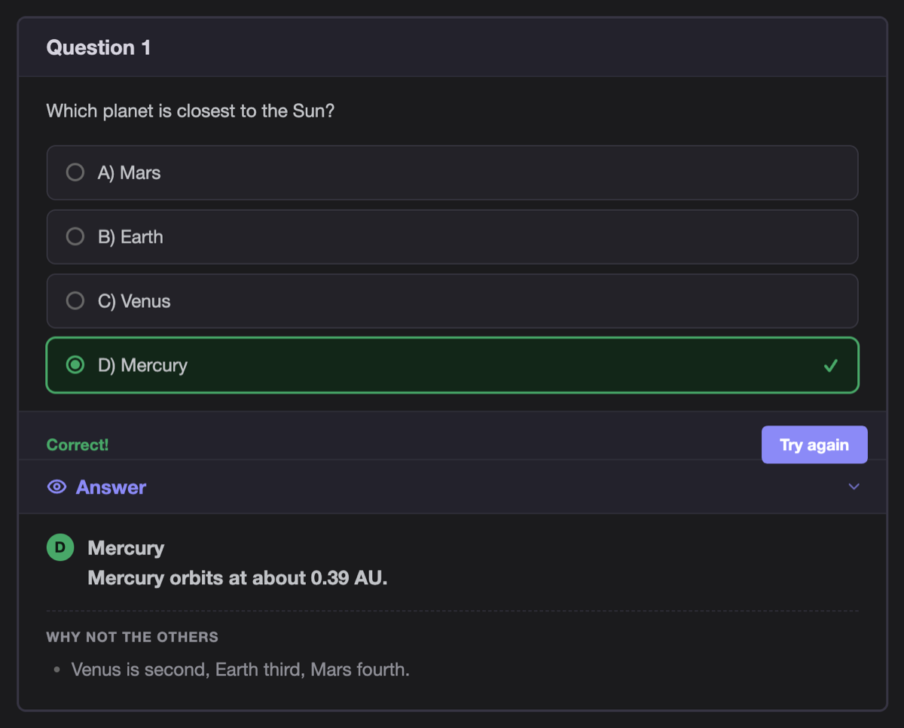
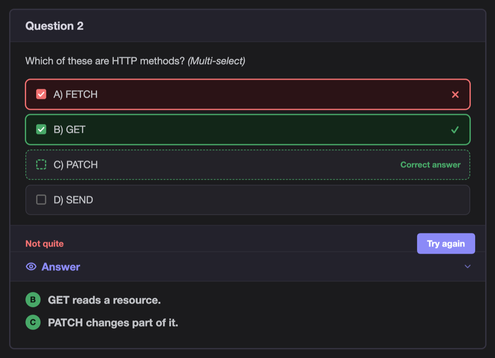
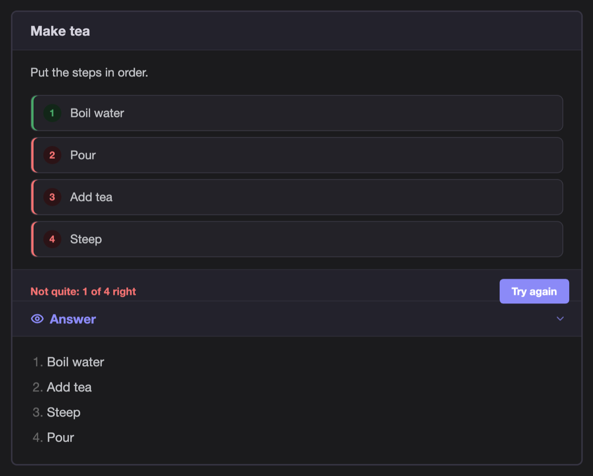
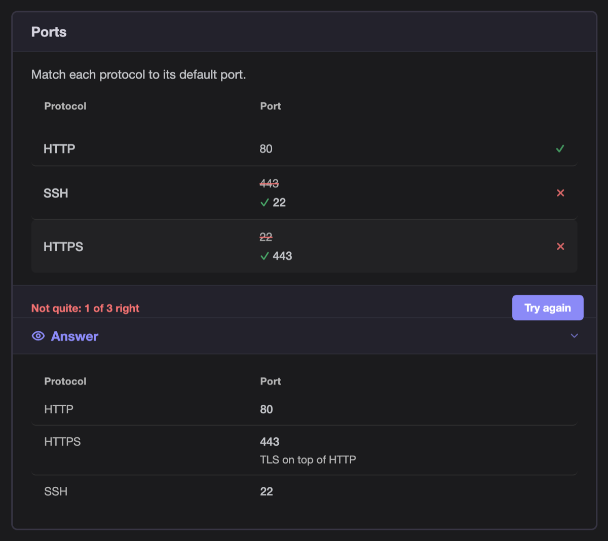
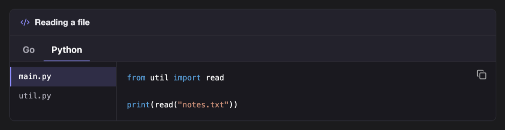
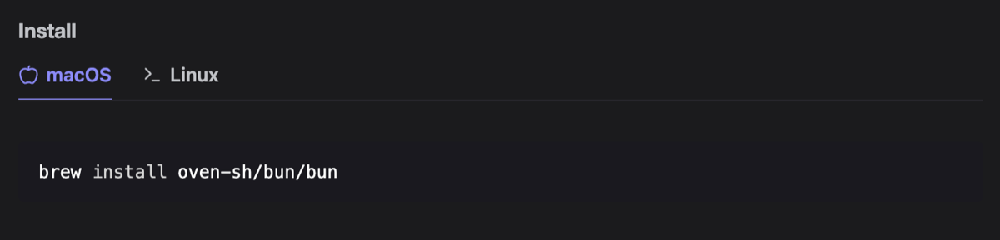
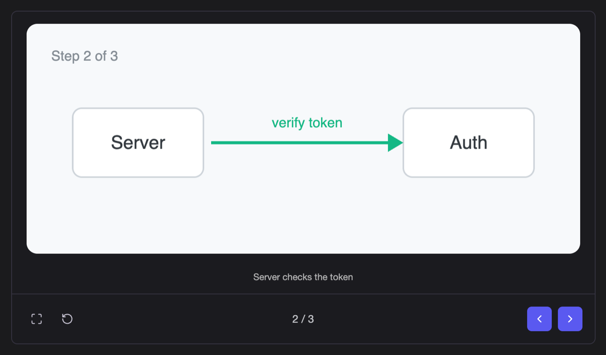
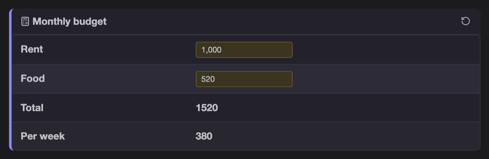
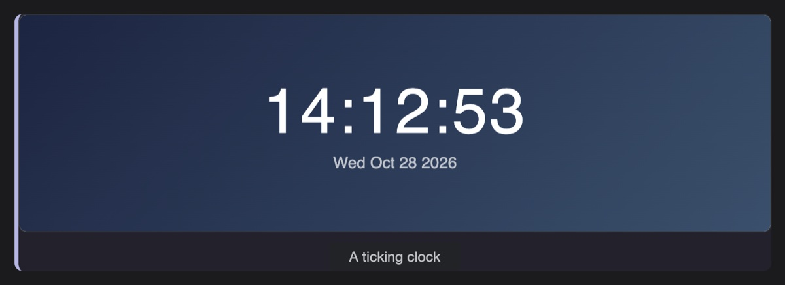

# Quizcraft

Quizcraft turns plain Obsidian callouts into interactive widgets. Notes stay
ordinary Markdown: without the plugin they still read as a question followed by
its answer, and the plugin never writes to a note.

Coming from 0.1.x? The `quizcraft` YAML code block is gone. Each question is
now a `[!quiz]` callout; see [Quiz cards](#quiz-cards).

## Install

Quizcraft is not in the community plugin list yet. Until it is, install a
release by hand or through BRAT.

**Manual**

1. Download `main.js`, `manifest.json` and `styles.css` from the
   [latest release](https://github.com/quannh-netalik/quizcraft/releases/latest).
2. Put them in `<vault>/.obsidian/plugins/quizcraft/`.
3. Reload Obsidian and enable **Quizcraft** under *Settings → Community plugins*.

**BRAT**

1. Install the [BRAT](https://github.com/TfTHacker/obsidian42-brat) plugin.
2. Run *BRAT: Add a beta plugin for testing* with `quannh-netalik/quizcraft`.
3. Enable **Quizcraft** under *Settings → Community plugins*.

Quizcraft works on desktop and mobile and needs Obsidian 1.5 or later.

## Quick example

```markdown
> [!quiz] Which HTTP status means "not found"?
> - A) 301
> - B) 404
> - C) 500
>
> ==Answer==
>
> B) 404
```

In Reading view or Live Preview this is a card with three options and a
**Submit Answer** button. Without the plugin it reads as the question with its
answer underneath.



## Markdown contract

Each widget is a callout. The callout type picks the widget; the callout
metadata (`[!type|meta]`) carries widget options.

| Callout | Widget |
| --- | --- |
| `[!quiz]` | Multiple-choice question graded on submit |
| `[!quiz\|order]` | Put the steps in the right order |
| `[!quiz\|match]` | Match each item on the left to one on the right |
| `[!code]` | Code editor with language tabs and file panes |
| `[!tabs]` | Content tabs |
| `[!carousel]` | Image slides, one at a time |
| `[!calc\|formulas]` | Spreadsheet table with live formulas |
| `[!demo\|height]` | HTML file run in a sandboxed frame |

Rules shared by every widget:

- The plugin reads the rendered callout and never edits the source note.
- A callout the plugin cannot parse is left exactly as Obsidian rendered it.
- Answers live in the note itself, after a `==Answer==` marker line.

## Quiz cards

A `[!quiz]` callout is a question card. A line holding only `==Answer==`
starts the answer: everything after it moves into a collapsible
**Show answer** section at the bottom of the card.

```markdown
> [!quiz] Question 1
> Which planet is closest to the Sun?
> - A) Venus
> - B) Mercury
> - C) Mars
>
> ==Answer==
>
> **B)** Mercury
> Mercury orbits at about 0.39 AU.
>
> **Why not the others**
> - Venus is second, Mars is fourth.
```

- A line starting with a bold letter (`**B)**` or `**B.**`) is a key line and
  shows the letter as a badge. Write one key line per correct option.
- A line holding only `**Why not the others**` starts a muted sub-section; the
  list after it belongs to it.
- Without an `==Answer==` line, or with nothing after it, the card has no
  answer section.

### Grading

A card whose list has two or more lettered options (`- A) text` or
`- A. text`) becomes an interactive quiz:

1. Click an option to pick it. **Submit Answer** stays disabled until you pick one.
2. **Submit Answer** grades the picks against the key lines. Picked options turn
   green or red; a correct option you did not pick gets a dashed border.
3. The answer section, hidden until now, opens below the footer.
4. **Try again** clears the picks and hides the answer again.

Two or more key lines make the quiz multi-select (checkboxes). A question
with one right option can still ask for checkboxes by containing
`*(Multi-select)*`. A quiz with no key lines shows *No answer key found*
instead of grading.



### Order quizzes

`[!quiz|order]` lists the steps as bullets. The numbered list after
`==Answer==` is the right order:

```markdown
> [!quiz|order] Make tea
> Put the steps in order.
> - Pour
> - Boil water
> - Steep
> - Add tea
>
> ==Answer==
>
> 1. Boil water
> 2. Add tea
> 3. Steep
> 4. Pour
```

- The steps start shuffled, never already in the right order.
- Drag a tile with the mouse, or with the grip on a touch screen. A focused
  tile also moves with ArrowUp and ArrowDown.
- **Submit Answer** marks every position and shows the score, for example
  *Not quite: 2 of 4 right*. **Try again** shuffles the steps again.
- Step text must match the key exactly; a quiz with fewer than two key items
  stays a plain card.



### Match quizzes

`[!quiz|match]` has two bullet lists: the items on the left, then the choices.
A bold paragraph above each list labels the column. The answer pairs each
left item with its choice, in bold, in the order of the left list:

```markdown
> [!quiz|match] Ports
> Match each protocol to its default port.
>
> **Protocol**
> - HTTP
> - HTTPS
> - SSH
>
> **Port**
> - 22
> - 80
> - 443
>
> ==Answer==
>
> - HTTP → **80**
> - HTTPS → **443**
>   - TLS on top of HTTP
> - SSH → **22**
```

- Each left item gets a picker. It opens a menu of the choices, in random
  order; the rows are shuffled too.
- A choice is used once: picking one another row holds swaps the two rows.
- **Submit Answer** is enabled once every row has a pick. Wrong picks are
  struck through, with the right choice under them.
- The answer shows as a two-column table; a nested bullet is a hint under
  its answer.
- The quiz stays a plain card unless every left item has a bold answer.



## Code editors and tabs

`[!code]` draws a dark code editor. Each `[!tab]` inside it is one language;
each tab holds one code block, or `[!file]` callouts when the example has
several files:

```markdown
> [!code] Reading a file
>> [!tab] Go
>> ```go
>> data, err := os.ReadFile("notes.txt")
>> ```
>
>> [!tab] Python
>>> [!file] main.py
>>> ```python
>>> from util import read
>>> ```
>>
>>> [!file] util.py
>>> ```python
>>> def read(path): ...
>>> ```
```

- One file shows its name above the code; two or more get a file list on the
  left.
- With a single language, put the `[!file]` callouts straight under `[!code]`.
- Picking a language switches every editor that has it, and later editors
  open on it.
- `> [!code]` with no caption hides the default "Code" title.



`[!tabs]` makes plain content tabs. Each `[!tab]` is one tab and holds any
Markdown. `[!tab|leaf]` shows the [Lucide](https://lucide.dev) icon `leaf`
before the name. Each `[!tabs]` box keeps its own selection.

```markdown
> [!tabs] Install
>> [!tab|apple] macOS
>> `brew install bun`
>
>> [!tab|terminal] Linux
>> `curl -fsSL https://bun.sh/install | bash`
```



## Carousel

`[!carousel]` with two or more image embeds shows them as slides, one at a
time:

```markdown
> [!carousel]
> ![[request-1.png|Client sends the request]]
> ![[request-2.png|Server checks the token]]
> ![[request-3.png]]
```

- The text after `|` is the caption. An embed without one has no caption.
- Use the footer buttons, click the slide, or press the arrow keys while the
  carousel has focus.
- The box keeps the height of the tallest slide, so the footer does not move.



## Calc

`[!calc]` turns a table into a small spreadsheet. Formulas go in the callout
metadata, `;` between them:

```markdown
> [!calc|B3=B1+B2;B4=round(B3/4,1)] Monthly budget
> | | |
> |---|---|
> | Rent | ==1,000== |
> | Food | ==400== |
> | Total | 1400 |
> | Per week | 350 |
```

- The table body is the grid: row 1, column 1 is `A1`. The header row is not
  part of it.
- `==value==` cells become inputs. Every edit recomputes the formula cells.
- The title gets a reset button that restores the values from the note.
- Keep the computed values in the note too: they show where the plugin is
  not installed.



Formula language:

| Syntax | Meaning |
|---|---|
| `12`, `1.5` | numbers |
| `B2` | the value of a cell; text that is not a number counts as 0 |
| `+ - * /` | arithmetic, usual precedence |
| `^` | power, right-associative: `2^3^2` is `2^9` |
| `( )` | grouping |
| `round(x)`, `round(x, digits)` | round; negative digits round to tens, hundreds, … |
| `ceil(x, digits)`, `floor(x, digits)` | round up or down, digits as for `round` |

A formula outside this language keeps the value the note shows. A result that
is not a number, such as division by zero, shows `—`. Formulas that refer to
each other in a loop stop at the value written in the note.

## HTML demo

`[!demo]` runs an HTML file from the vault in a frame under the text:

```markdown
> [!demo|320] A ticking clock
> [[clock.html]]
```

- The number after `|` is the frame height in pixels; the default is 400.
- The title becomes a caption under the frame. Leave it out, or keep the
  default "Demo", for no caption.
- The page runs with scripts on, sandboxed: it cannot reach the vault,
  Obsidian, or the note around it.
- When the link does not point to an `.html` file in the vault, the callout
  stays a plain link, so the note still shows what is missing.



## Settings

Settings → Quizcraft has two toggles. A change applies to notes rendered after
it; reopen a note to see it.

| Setting | Default | Effect |
|---|---|---|
| Shuffle quiz options | on | Deal multiple-choice options in random order. Off keeps the markdown order. Order and match quizzes always shuffle, because their order is the question. |
| Remember code language | on | Open code editors on the language picked last, in every note and after a restart. Off opens each editor on its first tab; picking a tab still switches the other open editors. |

## Development

Requires [Bun](https://bun.sh) 1.4 or later.

```sh
bun install
bun run dev      # unminified build to main.js
bun run check    # typecheck, lint, test
bun run build    # production build
bun run bump 0.3.0  # set version in package.json, manifest.json, versions.json
```

### Project layout

```text
src/main.ts              plugin entry: settings, setting tab, one markdown post-processor
src/settings/            QuizcraftSettings, DEFAULT_SETTINGS and the setting tab
src/widgets/registry.ts  Widget interface and the ordered widget list
src/widgets/quiz/        [!quiz] card, answer section, choice, order and match grading, shared footer
src/widgets/code/        [!code] editor, [!file] panes, [!tabs] and the shared tab bar
src/widgets/carousel/    [!carousel] image slides
src/widgets/calc/        [!calc] formula parser and spreadsheet
src/widgets/demo/        [!demo] sandboxed HTML frame
src/lib/                 DOM helpers and shuffle, shared by widgets
styles/                  one stylesheet per widget; build.ts joins them into styles.css
tests/stubs/             obsidian API stand-ins and DOM helpers for happy-dom
tests/helpers/           callout fixtures
tests/<area>/            tests, one folder per src area
scripts/                 release tooling
```

A new widget gets its own folder under `src/widgets/`, exports a `Widget`,
and is added to `WIDGETS` in the registry. The layout follows what most
large community plugins do (Dataview, Templater, Tasks, obsidian-git): a thin
entry file, one folder per feature, stubs kept beside the tests.

### Testing in a vault

Link the repo into a test vault so each build is picked up on reload:

```sh
ln -s "$PWD" /path/to/vault/.obsidian/plugins/quizcraft
bun run dev
```

Then enable **Quizcraft** under *Settings → Community plugins* and run
*Reload app without saving* after each build. Check both Reading view and
Live Preview: Live Preview re-renders callouts while you type.

## License

MIT
